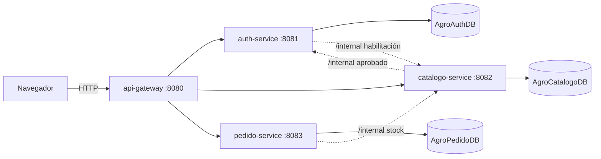
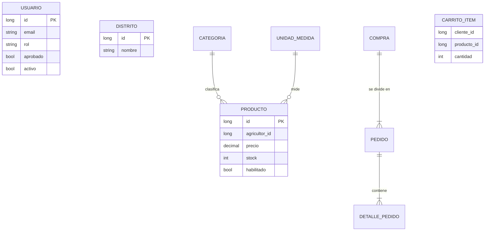

# Arquitectura

## Modelo de datos (una base por servicio, sin claves foráneas entre bases)

`PRODUCTO.agricultor_id`, `COMPRA.cliente_id` y `PEDIDO.agricultor_id` referencian a `USUARIO` (otro servicio) solo por ID.

## Decisiones

| Decisión | Motivo |
|---|---|
| 3 servicios + gateway | Separa seguridad, inventario y ventas, sin fragmentar de más para un equipo pequeño |
| Una base por servicio | Cada servicio es dueño de sus datos |
| JWT firmado compartido | Cada servicio valida el token sin llamar al de autenticación |
| Reserva de stock con bloqueo pesimista | Evita vender el mismo stock dos veces con compras simultáneas |
| SSE en lugar de SignalR | Avisos en tiempo real sin dependencias adicionales |
